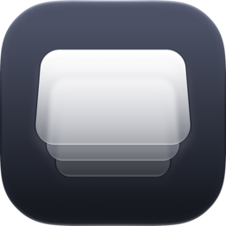
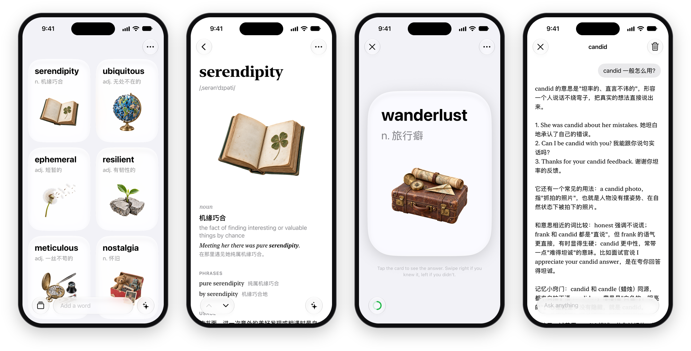
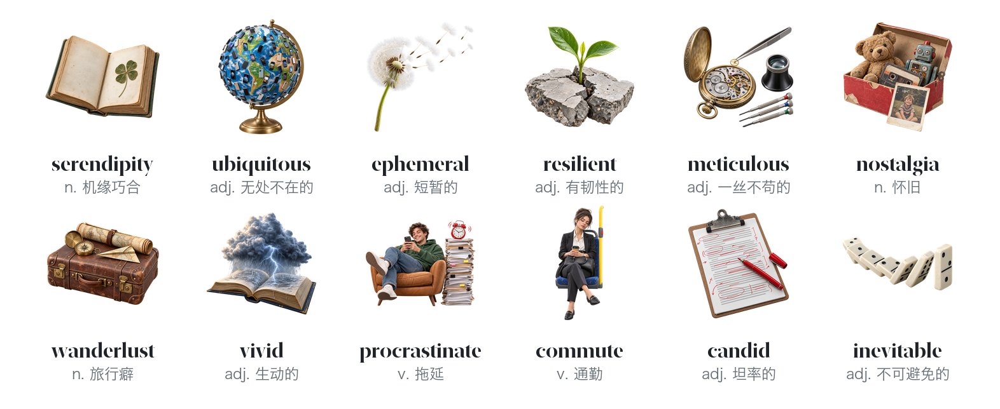

  

<h1 align="center">Cue</h1>

  给中文母语者的英语生词本。 
  输入单词，或者直接说你想表达的意思：AI 写好词条，再配一张图。

  
  
  
  

<a href="README.md">English</a> · <b>简体中文</b>

<picture>
  <source media="(prefers-color-scheme: dark)" srcset=".github/images/screens-dark.png">
  
</picture>

## 功能

- **想到什么就加什么。** 英文单词、中文，或者一句描述都行。Cue 会找到对应的英文，写出词典式的词条：音标、中文释义、例句、常用搭配、用法和词源。
- **每个词一张图。** 根据词条，为每个词画一张插图。
- **听发音。** 点词头、例句或搭配，就能听到自然的美式发音。
- **在快忘的时候复习。** 卡片按遗忘规律（FSRS-6）回来。点卡片看答案，记得就右滑。角落的圆环随着今天的复习一点点填满。
- **问 AI。** 可以问某一个词，也可以问整面墙上的词。
- **存在你的 iCloud。** 生词和对话会同步到你的其他设备，删掉重装也不会丢。

<picture>
  <source media="(prefers-color-scheme: dark)" srcset=".github/images/pictures-dark.png">
  
</picture>

## AI

AI 用的是 OpenAI 的模型，有两种用法：

- **点数**：在 app 里购买。Cue 的服务器按每次请求在 OpenAI 的实际花费扣点。别人加过的词直接从共享词库取，只要 0.2 点。
- **你自己的 OpenAI API Key**：app 直接连 OpenAI，不经过 Cue 的服务器。

## 结构

| | |
| --- | --- |
| [`Cue/`](Cue) | app 本体：SwiftUI、SwiftData + CloudKit 同步、StoreKit 2 |
| [`server/`](server) | Cloudflare Worker（D1 + R2）：账户、点数、购买和共享词库 |
| [`site/`](site) | 支持页和隐私政策，见 [chenyeni.com/cue](https://chenyeni.com/cue/) |
| [`tools/`](tools) | 配图生成、模型对比、网站发布、App Store 导出 |

## 构建

用 Xcode 27 打开 `Cue.xcodeproj`，选你自己的开发团队，在 iOS 27 上运行；装到真机还要换成你自己的 Bundle ID 和 iCloud 容器。要用 AI，在 Settings → AI → My OpenAI Key 里填 OpenAI API Key。服务器的部署见 [`server/README.md`](server/README.md)。

## 许可证

[Apache 2.0](LICENSE)
